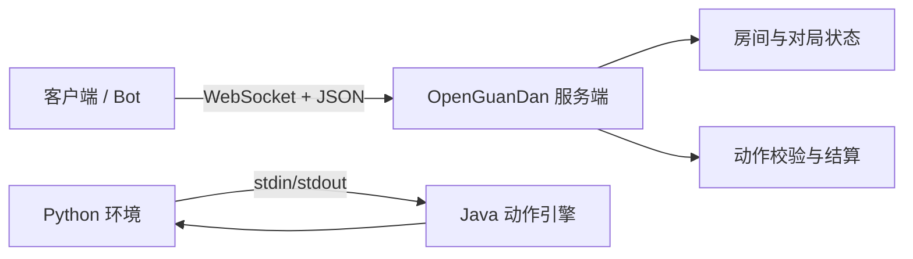

<div align="center">


# OpenGuanDan

### 面向掼蛋 AI、客户端与规则研究的开放式游戏服务

一个可运行的掼蛋服务端、WebSocket 协议和 Python 规则引擎桥接层。

[](https://adoptium.net/)
[](https://www.python.org/)
[](#websocket-协议)
[](#部署服务端)
[](https://arxiv.org/abs/2602.00676)
[](https://openguandan.github.io/)

[快速开始](#快速开始) · [架构概览](#架构概览) · [Python 桥接](#python-桥接) · [WebSocket 协议](#websocket-协议) · [开发说明](#开发说明)

<p>
  <a href="https://openguandan.github.io/">
    
  </a>
</p>
<sub>OpenGuanDan 模拟器界面示例，支持中文和英文。</sub>

</div>

OpenGuanDan 将掼蛋的发牌、出牌、进贡、还贡和结算流程封装成可连接的游戏服务。它适合用来：

- 启动一个可供客户端或 Bot 连接的掼蛋服务；
- 通过 WebSocket 以 JSON 交换房间、动作和对局状态；
- 在 Python 中调用 Java 动作引擎，生成合法动作并做环境 smoke test；
- 在统一规则下进行 AI、客户端和协议层开发。

> 当前仓库是一个可直接运行的发布快照。服务端发布包、Python 桥接和协议示例都已包含在仓库中。

## 目录

- [快速开始](#快速开始)
- [架构概览](#架构概览)
- [论文与可视化资源](#论文与可视化资源)
- [部署服务端](#部署服务端)
- [Python 桥接](#python-桥接)
- [WebSocket 协议](#websocket-协议)
  - [连接与消息格式](#连接与消息格式)
  - [客户端消息](#客户端消息)
  - [服务端通知](#服务端通知)
  - [动作请求](#动作请求)
  - [数据约定](#数据约定)
- [仓库结构](#仓库结构)
- [开发说明](#开发说明)

## 快速开始

### 1. 启动原生服务端

Linux：

```bash
git clone https://github.com/GameAI-NJUPT/OpenGuanDan.git
cd OpenGuanDan
chmod +x guandan-linux
./guandan-linux
```

Windows：

```powershell
git clone https://github.com/GameAI-NJUPT/OpenGuanDan.git
cd OpenGuanDan
.\guandan.exe
```

默认端口：

| 用途 | 地址 |
| --- | --- |
| HTTP | `http://127.0.0.1:3000` |
| WebSocket | `ws://127.0.0.1:8181` |

### 2. 运行 Python 桥接 smoke test

需要 Python 3 和 JDK 17+：

```bash
cd guandan-java
python3 run_smoke.py
```

成功时会检查动作解析，并执行一段随机对局走子：

```text
[ok] parse_first_action: ... moves
[ok] parse_second_action: first is PASS
[ok] random walk ~2.0s, play steps ~...
```

### 3. 连接 WebSocket

服务端启动后，客户端连接 `ws://127.0.0.1:8181`，使用 UTF-8 编码的 JSON 收发消息。动作必须从服务端返回的 `actionList` 中选择，不能自行拼接未列出的动作。

## 架构概览



- **服务端**：处理房间、四人座位、对局阶段和消息广播。
- **协议层**：以 JSON 描述创建房间、加入房间、出牌、进贡和还贡动作。
- **动作引擎**：`guandan-java/guandan-java-action.jar` 为 Python 环境提供合法动作列表和规则判断。
- **原生发布包**：`guandan-linux` 与 `guandan.exe` 用于直接启动服务。

## 论文与可视化资源

论文将 OpenGuanDan 定义为一个面向**不完美信息、多智能体协作与竞争、长时序决策和可变动作空间**的掼蛋 benchmark，并介绍了独立玩家 API、模拟器和内置智能体。

| 资源 | 用途 |
| --- | --- |
| [项目官网](https://openguandan.github.io/) | 查看模拟器预览、对局演示和项目介绍 |
| [平台文档 PDF](https://openguandan.github.io/static/Guandan%20Platform%20Documentation.pdf) | 查看平台部署、API 和使用说明 |
| [论文 PDF](https://arxiv.org/pdf/2602.00676v1) | 下载论文 |
| [牌型与牌力可视化](https://arxiv.org/html/2602.00676v1#A1.F3) | 查看单牌、对子、顺子、炸弹等组合及排序 |
| [模拟器 API 示例](https://arxiv.org/html/2602.00676v1#A3) | 查看出牌、进贡和还贡阶段的调用方式 |

论文中的资源用于说明项目背景和交互方式；性能数字与实验结论请以论文原文为准，不等同于本仓库快照的即时测量。

## 部署服务端

### 原生发布包

仓库根目录的原生程序是最短部署路径：

```bash
# Linux
chmod +x guandan-linux
./guandan-linux
```

```powershell
# Windows
.\guandan.exe
```

服务端默认使用 HTTP `3000` 和 WebSocket `8181`。如需将服务暴露给其他机器，请在防火墙和反向代理中同时处理对应端口，并按实际部署环境配置访问控制。

### Java 服务端 artifact

`guandan-java-1.0.0.jar` 保存了 Java 服务端类；它不是包含全部第三方依赖的独立可执行 JAR。直接执行 `java -jar guandan-java-1.0.0.jar` 不适用于当前快照。需要在 Java/Maven 工程中补齐 Netty 等依赖后，再以 `com.guandan.GuandanServer` 作为入口启动。

## Python 桥接

`guandan-java/` 提供一个轻量 Python 环境和 Java 动作引擎桥接层：

```text
guandan-java/
├── engine/
│   ├── environment.py  # 对局环境与阶段循环
│   ├── moves.py        # 动作解析和 Java 进程桥接
│   ├── table.py        # 牌桌状态
│   └── types.py        # 动作、牌和玩家类型
├── guandan-java-action.jar
├── run_smoke.py
└── README.md
```

环境变量：

| 变量 | 作用 |
| --- | --- |
| `GUANDAN_JAVA_JAR` | 指定动作引擎 JAR 的绝对路径 |
| `GUANDAN_JAVA_ACTION_CMD` | 使用自定义 Java 启动命令 |
| `GUANDAN_JAVA_MODE` | `worker` 或 `oneshot`，默认 `worker` |
| `GUANDAN_JAVA_CACHE_SIZE` | 动作缓存条目数，默认 `20000` |

更细的 Python API 说明见 [`guandan-java/README.md`](guandan-java/README.md)。

## WebSocket 协议

### 连接与消息格式

连接地址：

```text
ws://127.0.0.1:8181
```

消息采用 JSON：

```json
{
  "type": "MESSAGE_TYPE",
  "data": {}
}
```

### 客户端消息

#### 创建房间：`CREATE_ROOM`

```json
{
  "type": "CREATE_ROOM",
  "data": {
    "userId": "user1",
    "round": 1,
    "seatNum": 0
  }
}
```

`userId` 必须唯一；`seatNum` 可选，取值为 `0` 到 `3`。成功响应会返回 `roomId`。

#### 加入房间：`JOIN_ROOM`

```json
{
  "type": "JOIN_ROOM",
  "data": {
    "userId": "user2",
    "roomId": 1,
    "seatNum": 1
  }
}
```

房间达到 4 名玩家后自动开始对局。

#### 出牌：`PLAY`

```json
{
  "type": "PLAY",
  "data": {
    "roomId": 1,
    "player": 0,
    "act": ["Single", "2", ["S2"]]
  }
}
```

`act` 必须是当前 `actionList` 中的完整动作。过牌使用 `["PASS", "PASS", "PASS"]`。

#### 进贡：`TRIBUTE`

```json
{
  "type": "TRIBUTE",
  "data": {
    "roomId": 1,
    "player": 0,
    "act": ["tribute", "tribute", ["D2"]]
  }
}
```

#### 还贡：`PAYTRIBUTE`

```json
{
  "type": "PAYTRIBUTE",
  "data": {
    "roomId": 1,
    "player": 0,
    "tributePos": 3,
    "tribute": "S2",
    "act": ["back", "back", ["H2"]]
  }
}
```

`tributePos` 和 `tribute` 必须原样复用服务端在还贡请求中给出的值。

### 服务端通知

服务端向房间内玩家广播 `type: "notify"` 消息，`stage` 取值包括：

| 阶段 | 关键字段 | 含义 |
| --- | --- | --- |
| `beginning` | `handCards`, `myPos` | 对局开始与初始手牌 |
| `play` | `curPos`, `curAction`, `greaterAction` | 出牌状态变化 |
| `tribute` | `result` | 进贡结果 |
| `anti-tribute` | `antiNums`, `antiPos` | 抗贡结果 |
| `back` | `result` | 还贡结果 |
| `episodeOver` | `order`, `curRank`, `restCards` | 本局结束 |
| `gameOver` | `curTimes`, `settingTimes` | 设定轮次结束 |
| `gameResult` | `victory`, `victoryRank` | 最终胜负与等级 |

示例：

```json
{
  "type": "notify",
  "stage": "gameResult",
  "victory": 0,
  "victoryRank": ["A", "K"]
}
```

### 动作请求

服务端向当前玩家发送 `type: "act"` 消息。`stage` 为 `play`、`tribute` 或 `back`，客户端从 `actionList` 选择 `actIndex` 对应动作，再发送相应的 `PLAY`、`TRIBUTE` 或 `PAYTRIBUTE` 消息。

出牌请求的核心字段：

```json
{
  "type": "act",
  "stage": "play",
  "handCards": ["S2", "H2"],
  "publicInfo": [{"rest": 22}, {"rest": 23}, {"rest": 23}, {"rest": 27}],
  "selfRank": "K",
  "oppoRank": "9",
  "curRank": "K",
  "curPos": 2,
  "curAction": ["PASS", "PASS", "PASS"],
  "greaterAction": ["Single", "2", ["S2"]],
  "greaterPos": 2,
  "actionList": [["PASS", "PASS", "PASS"], ["Single", "2", ["S2"]]],
  "indexRange": 1
}
```

### 数据约定

- **牌**：`{Suit}{Rank}`，花色为 `S/H/C/D`，点数为 `A, 2-9, T, J, Q, K, B, R`。
- **动作**：`[Pattern, Rank, CardList]`，例如 `["Pair", "4", ["H4", "C4"]]`。
- **牌型**：`Single`、`Pair`、`Trips`、`ThreePair`、`ThreeWithTwo`、`TwoTrips`、`Straight`、`StraightFlush`、`Bomb`、`FourKings`、`tribute`、`back`、`PASS`。
- **座位**：固定为 `0`、`1`、`2`、`3`；座位 `0/2` 为 Team 0，座位 `1/3` 为 Team 1。
- **动作一致性**：动作必须完整匹配服务端 `actionList` 中的条目，包括牌的顺序。
- **断线**：当前协议不提供自动重连；断线后需要重新建立连接并重新加入房间。
- **还贡**：还贡牌不能高于 10（`J`、`Q`、`K`、`A` 等不符合规则）。

## 仓库结构

```text
.
├── guandan-linux                # Linux 原生服务端
├── guandan.exe                  # Windows 原生服务端
├── guandan-java-1.0.0.jar       # Java 服务端 artifact
└── guandan-java/
    ├── guandan-java-action.jar  # Python 桥接使用的动作引擎
    ├── engine/                   # Python 环境、牌桌与动作类型
    ├── run_smoke.py              # 最小可运行验证
    └── README.md                 # Python 桥接说明
```

## 开发说明

### 修改协议前

1. 先确认服务端广播和动作请求的字段是否同步变化。
2. 更新本 README 中的请求、响应和字段说明。
3. 在 `guandan-java/` 运行 `python3 run_smoke.py`，确认动作解析和环境循环仍可用。

### 多线程模式

Java 服务端配置支持集群模式和 Worker 数量；原生发布包使用默认配置启动。若你维护 Java 服务端工程，可按以下属性配置：

```properties
guandan.cluster.mode=true
guandan.cluster.workers=4
server.port=8182
```
